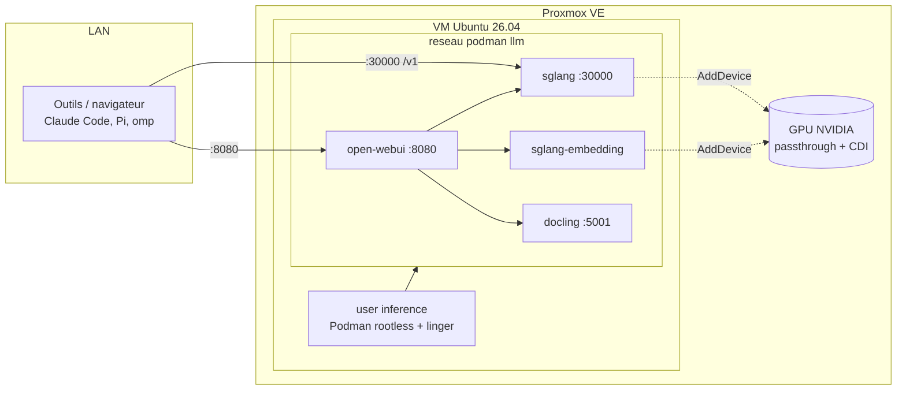

# llm-inference-vm

Infrastructure d'une VM dédiée à l'inférence LLM locale, sur Proxmox VE :

- **`iac/`** — création de la VM (Ubuntu 26.04 Cloud-Init, OpenTofu + provider `bpg/proxmox`), avec passthrough GPU NVIDIA optionnel (`pci_devices`).
- **`ansible/`** — provisionnement post-boot : sécurisation, Podman rootless, compte de service non-admin, puis services LLM (SGLang, Open WebUI, Docling) en conteneurs rootless gérés par Quadlet.

Démarrage rapide : voir **[QUICKSTART.md](QUICKSTART.md)**.

## Architecture



Tous les services applicatifs tournent sous le compte non-admin `inference` en Podman rootless (unités systemd user générées depuis des Quadlets dans `~/.config/containers/systemd/`), sur un réseau Podman partagé `llm` où les conteneurs se joignent par nom. Le GPU est exposé aux conteneurs via la spécification CDI NVIDIA (`AddDevice=nvidia.com/gpu=all`) — pas de `--privileged`, pas de gVisor (incompatible GPU).

Inspiré de [`iac-ai-agent`](../iac-ai-agent) : mêmes patterns OpenTofu et rôles de base (sécurisation, Podman, user de service), sans les concepts d'agents/brokers.

## Prérequis

- **Poste de pilotage** : `tofu` (OpenTofu ≥ 1.8), `ansible-core` + `community.general`, `ansible-lint` (profil production), SSH.
- **Proxmox VE** : token API `root@pam` (ou équivalent) avec droits sur le node ; datastore d'images et de snippets `local`.
- **Réseau** : une bridge reachable depuis le poste (la VM prend une IP statique via Cloud-Init).
- Pour l'airgap : en plus, un builder Ubuntu 26.04 amd64 avec accès internet (voir plus bas).

## Structure

```
iac/                                  # OpenTofu — création de la VM
  providers.tf                        #   provider bpg/proxmox
  main.tf                             #   VM unique (q35/ovmf, hostpci GPU, cloud-init)
  variables.tf                        #   ressources, réseau, GPU, accès
  outputs.tf                          #   vm_id, vm_ips
  terraform.tfvars.example            #   à copier en terraform.tfvars (gitignoré)

ansible/
  playbook.yml                        # ... → nvidia → sglang → docling → open_webui
  playbook-download.yml               #   airgap : construction du bundle (hosts: bundle_builder)
  ansible.cfg                         # inventory/ + roles_path ./roles
  inventory/inventory.yml.example      #   à copier en inventory.yml (gitigné)
  group_vars/all.yml.example          #   à copier en all.yml (gitigné)
  roles/
    system_timezone                   #   timezone + NTP (systemd-timesyncd)
    essential_packages               #   socle de paquets + qemu-guest-agent
    developer_config                 #   vim + git (système)
    security_hardening               #   SSH (clés uniquement), sysctl, fail2ban, unattended-upgrades,
                                      #   auditd, AppArmor, umask, pwquality, journald, coredumps off
    inference_user                    #   user non-admin "inference" : linger, socket Podman rootless,
                                      #   clés SSH
    podman                            #   Podman rootless (+ compat docker/compose), délégation cgroup v2,
                                      #   réseau partagé "llm" (quadlet)
    firewall                          #   UFW : deny incoming, allow outgoing, rate-limit SSH
    nvidia                            #   driver headless + nvidia-container-toolkit + spec CDI
                                      #   (AddDevice=nvidia.com/gpu=all) — flag nvidia_enabled
    sglang                            #   moteur d'inférence CUDA (quadlet), décodage spéculatif DFlash2 :
                                      #   sglang_model_path + sglang_draft_model_path configurables,
                                      #   API OpenAI-compatible sur :30000 (LAN) — flag sglang_enabled.
                                      #   + instance embedding RAG (sglang_embedding_enabled)
    docling                           #   docling-serve (parsing RAG), image CPU ou CUDA (docling_gpu),
                                      #   UI sur 127.0.0.1:5001, interne au réseau podman — flag docling_enabled
    open_webui                        #   chat + RAG sur :8080 (LAN), extraction de documents via
                                      #   docling, backend chat via sglang quand activé — flag open_webui_enabled
    bundle_download                   #   (builder) apt closure, images skopeo, modèles HF, artifacts
                                      #   docling, image cloud → airgap-bundle/
    airgap                            #   (VM) apt offline sur le repo local du bundle

airgap-bundle/                        #   bundle construit (gitigné, sauf .gitkeep)
```

## Déploiement

### 1. Créer la VM (OpenTofu)

```bash
cd iac
cp terraform.tfvars.example terraform.tfvars   # renseigner : API Proxmox, clé SSH, node, IP, GPU
tofu init
tofu apply
```

Sorties : `vm_id`, `vm_name`, `vm_ips`. Le passthrough GPU se déclare via `pci_devices` (mapping cluster Proxmox ou ID PCI direct) ; sans GPU, la VM démarre en CPU-only. Sur la VM GPU, mettre `efi_pre_enrolled_keys = false` (modules NVIDIA open non signés vs Secure Boot).

### 2. Provisionner (Ansible)

```bash
cd ansible
cp inventory/inventory.yml.example inventory.yml   # ansible_host = vm_ips
cp group_vars/all.yml.example group_vars/all.yml
ansible-playbook playbook.yml
```

Le playbook attend la fin de cloud-init, applique les rôles, puis reboote si un kernel a été mis à jour (`system_reboot_on_kernel_update`).

### 3. Accès

- Admin : `ssh ubuntu@<ip>` (user Cloud-Init).
- Services : `ssh inference@<ip>` — user non-admin, `systemctl --user`, socket Podman (`DOCKER_HOST=unix:///run/user/$(id -u)/podman/podman.sock`, déjà exporté dans son `.bashrc`).

### 4. Services LLM

Pilotés par flags dans `group_vars/all.yml` :

| Service | Flag | Détail |
|---|---|---|
| NVIDIA driver + toolkit CDI | `nvidia_enabled` | requis par tout usage GPU (le rôle assert qu'un GPU est présent) |
| SGLang (API OpenAI :30000) | `sglang_enabled` | modèle + draft DFlash2 via `sglang_model_path` / `sglang_draft_model_path` ; profil PRO 5000 48 GB dans le rôle |
| SGLang embedding (RAG `/v1/embeddings`) | `sglang_embedding_enabled` | 2ᵉ instance SGLang sur le même GPU : Qwen3-Embedding-0.6B (32K ctx, 1024-dim) ; debug `127.0.0.1:30001` ; Open WebUI branché dessus automatiquement |
| Docling (RAG parsing) | `docling_enabled`, `docling_gpu` | UI debug sur `127.0.0.1:5001/ui` |
| Open WebUI (:8080) | `open_webui_enabled` | auto-connecté à docling et sglang selon les flags |

Sur une VM sans GPU, seuls open_webui + docling (CPU) sont fonctionnels ; la VM GPU
ajoute `nvidia_enabled: true` + `sglang_enabled: true` (+ `sglang_embedding_enabled: true`,
`docling_gpu: true`, abordable sur la carte 48 GB).

Ports exposés :

| Port | Service | Exposition |
|---|---|---|
| 8080 | Open WebUI | LAN (UFW ouvert) |
| 30000 | SGLang API OpenAI-compatible | LAN (UFW ouvert) |
| 5001 | Docling UI | `127.0.0.1` uniquement |
| 30001 | SGLang embedding (debug) | `127.0.0.1` uniquement |

Exposition assumée : HTTP brut sur :8080/:30000 — le TLS est terminé par le
reverse-proxy interne (VLAN dédié). `sglang_api_key` (group_vars) protège
`:30000` par un bearer token (tout sauf `/health`, `/ready`, `/metrics`).
Sur `:8080`, le **premier compte créé devient admin** — créez-le immédiatement,
puis désactivez l'inscription dans le panneau admin.
La WebUI fait confiance aux en-têtes `X-Forwarded-*` du proxy
(`FORWARDED_ALLOW_IPS=*` : URLs https correctes, IPs clients dans les logs).
La clé de session (`WEBUI_SECRET_KEY`) est générée par Ansible et persiste dans
`~/open-webui/secret_key`.

## GPU cible : RTX PRO 5000 Blackwell 48 GB

sm120, NVFP4 supporté. Le profil SGLang par défaut (rôle `sglang`) est calibré
pour cette carte : modèle `unsloth/Qwen3.8-27B-NVFP4` (corps NVFP4 + lm_head FP8,
requiert SGLang >= v0.5.19) avec draft DFlash2 NVFP4 calibré (`maurienne-ai/...`).
Budget à `--mem-fraction-static 0.85` (max 40.8 GB) : ~18.5 GB de poids +
~3.5 GB de runtime → **~17 GB de KV fp8 ≈ 520K tokens**
(256K natif en mono-requête, ou 4 requêtes × ~130K). La KV 4-bit n'est pas
supportée sur ce modèle hybride-GDN — fp8_e4m3 est le plancher. Voir
https://docs.sglang.io/cookbook/autoregressive/Qwen/Qwen3.8-27B et
https://github.com/MiaAI-Lab/Qwen3.8-27B-RTX-6000-PRO-SGLang-DSpark.

Reste **4.8 GB** de VRAM libre (48 − 40.8 − 2.4 pour l'embedding à
`--mem-fraction-static 0.05`). Avec `docling_gpu: true` (contexte CUDA + OCR
~4-5 GB), le pool statique SGLang retombe automatiquement à `0.78`
(`sglang_mem_fraction_static`).

Blackwell (sm120) impose les **modules kernel open** (`-open` : le flavor
propriétaire ne supporte pas sm120) → Secure Boot désactivé sur la VM (DKMS non
signé). Le rôle `nvidia` assert ces deux points.

## Déploiement airgap

La VM d'inférence (et éventuellement le node Proxmox) n'ont pas d'accès
internet. Tout est embarqué dans un bundle construit ailleurs :

1. **Builder** — host Ubuntu 26.04 amd64 avec internet, idéalement une instance
   fraîche de la même image cloud que la VM (groupe `bundle_builder` de
   l'inventory) : la closure apt n'est correcte que dans ce cas. Le repo doit
   être cloné sur ce builder (sinon surcharger `bundle_download_dir` dans
   group_vars) :
   ```bash
   ansible-playbook playbook-download.yml
   ```
   Produit `<repo>/airgap-bundle/` (gitignoré) : repo apt local (`repo/`),
   images conteneurs (`images/`), snapshots HF (`models/`), artifacts Docling
   pré-bakés (`docling-artifacts/`), image cloud Ubuntu (`cloudimg/`).
2. **Transfert** — rsync/scp du bundle vers la VM à `/airgap-bundle`
   (`llm_bundle_dir`) ;
   pour un Proxmox isolé, uploader aussi `cloudimg/*.img` dans le datastore
   `local` du node (`/var/lib/vz/template/iso/`) et mettre
   `cloud_image_preuploaded = true` + `enable_cloudinit_snippet = false`
   dans `terraform.tfvars`.
3. **Installation** — dans `group_vars/all.yml` : `airgap_mode: true` (les
   chemins de modèles `/models/…`, `unattended-upgrades` off,
   `OFFLINE_MODE`/`HF_HUB_OFFLINE=1` suivent automatiquement), puis
   `ansible-playbook playbook.yml` comme d'habitude.

Le rôle `airgap` bascule apt sur le repo local du bundle (sources réseau
désactivées, échec avec instructions si le bundle est absent) ; les rôles
services chargent les images via `podman load` au lieu de pull (idempotent),
et SGLang sert les modèles depuis les répertoires montés avec `HF_HUB_OFFLINE=1`.

## Opérations

Tout tourne sous le user `inference` (linger activé → survit aux logout) :

```bash
ssh inference@<ip>
systemctl --user status sglang sglang-embedding docling open-webui
journalctl --user -u sglang -f           # logs du moteur
podman ps                                # conteneurs du réseau llm
systemctl --user restart open-webui      # après édition d'un quadlet :
systemctl --user daemon-reload           # toujours daemon-reload avant
```

Vérifications santé :

```bash
curl -s http://<ip>:8080/health          # Open WebUI
curl -s http://<ip>:30000/v1/models      # SGLang (-H "Authorization: Bearer <clé>" si sglang_api_key)
curl -s http://127.0.0.1:5001/health     # Docling (depuis la VM)
```

## Prochaines étapes

1. Passthrough GPU dans `terraform.tfvars` (`pci_devices`), puis déployer :
   vérifier `nvidia-smi`, SGLang + décodage DFlash2 end-to-end.
2. Sur le matériel réel : tenter `--max-running-requests 4 --cuda-graph-max-bs 4`
   (batched DFlash2 non vérifié) pour que plusieurs outils partagent l'API.

## Licence

Ce projet est sous licence MIT. Voir le fichier [LICENSE](LICENSE) pour plus de détails.
