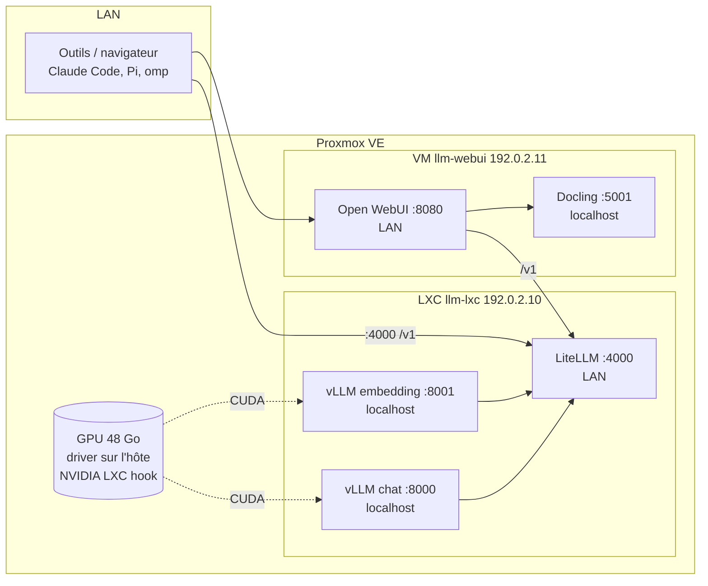

# llm-inference-vm

Stack d'inférence LLM locale sur Proxmox VE, séparée en deux machines :

- **LXC `llm-lxc`** (non privilégié, 192.0.2.10) : **vLLM** (chat +
  embeddings) et **LiteLLM** (proxy OpenAI-compatible, seule API exposée au
  LAN). Le GPU reste attaché à l'hôte Proxmox et est injecté dans le LXC par le
  hook NVIDIA de Proxmox + les règles cgroup — **pas de passthrough PCI/VFIO**.
- **VM `llm-webui`** (192.0.2.11) : **Open WebUI** (:8080) et **Docling**
  (:5001, localhost). Aucun GPU, aucun vLLM/SGLang/NVIDIA dans cette VM.

LiteLLM est le seul point d'entrée pour les utilisateurs/outils ; vLLM n'est
jamais exposé directement. Open WebUI et les outils de code (Pi, omp, etc.)
passent par LiteLLM.

## Architecture



## Ce qui tourne où

| Composant | Machine | Exposition | Rôle |
|---|---|---|---|
| vLLM chat | LXC 120 | `127.0.0.1:8000` + réseau Docker interne | Qwen3.8-27B-NVFP4 + DFlash2 |
| vLLM embedding | LXC 120 | réseau Docker interne | Qwen3-Embedding-0.6B |
| LiteLLM | LXC 120 | LAN `:4000` | proxy, master key, seul endpoint public |
| Open WebUI | VM 112 | LAN `:8080` | chat + RAG |
| Docling | VM 112 | `127.0.0.1:5001` | parsing PDF pour le RAG |

Ports LAN : `8080` (Open WebUI), `4000` (LiteLLM). `8000/8001/5001` restent
locaux. Le TLS est terminé par le reverse-proxy interne, comme avant.

## Prérequis

- **Proxmox VE 9.2+**, `lxc-pve >= 6.0.5` (le host de test `pve-node1` est en 9.2.27
  avec `lxc-pve 7.0.0`).
- Driver NVIDIA + `nvidia-container-toolkit` sur l'hôte (voir
  [docs/HOST-INSTALL.md](docs/HOST-INSTALL.md)).
- Poste de pilotage : `tofu` (OpenTofu ≥ 1.11), `ansible-core` +
  `community.general`, une clé SSH.
- Pour l'airgap : un builder Ubuntu 26.04 amd64 avec internet (voir
  [docs/AIRGAP.md](docs/AIRGAP.md)).

## Structure

```text
iac/                                  # OpenTofu — LXC + VM front
  providers.tf                        #   bpg/proxmox
  main.tf                             #   LXC 120 + VM 112, template/cloud image
  variables.tf                        #   réseau (bridge/VLAN/IP), ressources
  outputs.tf                          #   lxc_ip, front_vm_ip, URLs
  terraform.tfvars.example

ansible/
  playbook.yml                        # play LXC + play VM front
  playbook-download.yml               # wrapper du script airgap (builder)
  inventory/inventory.yml.example
  group_vars/all.yml.example
  roles/
    airgap                            # apt local du bundle
    system_timezone                   # timezone (+ NTP sur la VM front)
    essential_packages                # paquets de base VM
    developer_config
    security_hardening                # SSH, fail2ban, auditd, AppArmor, UFW...
    inference_user                    # user non-admin, linger
    podman                            # Podman rootless (VM front)
    firewall                          # UFW (VM front)
    lxc_base                          # socle du LXC, SSH key-only
    lxc_docker                        # Docker + toolkit NVIDIA + smoke test
    inference_stack                   # compose vLLM/LiteLLM
    docling                           # docling-serve (CPU)
    open_webui                        # Open WebUI -> LiteLLM

scripts/
  proxmox-lxc-gpu.sh                  # features/hooks/cgroup/SHM/bundle LXC
  fetch-airgap-bundle.sh              # builder online : host + images + modèles
  test.pdf                            # PDF de validation Docling

docs/
  HOST-INSTALL.md                     # driver/toolkit/hooks/template Proxmox
  AIRGAP.md                           # build/transfert/installation offline
```

## Déploiement (mode online, host de test)

### 1. Préparer l'hôte Proxmox

Suivre [docs/HOST-INSTALL.md](docs/HOST-INSTALL.md) : driver NVIDIA, toolkit,
template LXC Ubuntu 26.04, image cloud. Le host `pve-node1` est déjà préparé.

### 2. Créer le LXC et la VM front

```bash
cd iac
cp terraform.tfvars.example terraform.tfvars
$EDITOR terraform.tfvars      # API Proxmox, SSH, node, bridge, IPs
tofu init
tofu apply
```

Valeurs par défaut : LXC `llm-lxc` **120** → `192.0.2.10/24`, VM
`llm-webui` **112** → `192.0.2.11/24`. Le bridge, la gateway, le VLAN et les
IPs sont des variables (`network_bridge`, `network_gateway`, `network_vlan_id`,
`lxc_ipv4`, `front_vm_ipv4`). L'ancienne VM 103 de l'ancienne archi est
détruite si elle est encore dans le state.

### 3. Ajouter les hooks GPU au LXC

Sur l'hôte Proxmox :

```bash
/path/to/repo/scripts/proxmox-lxc-gpu.sh 120
# airgap : ajouter --bundle /srv/airgap-bundle
```

Le script active `nesting/keyctl/fuse/mknod`, ajoute les règles cgroup des
majors NVIDIA détectés, le hook `/usr/share/lxc/hooks/nvidia`, 16 GiB de
`/dev/shm`, et vérifie `nvidia-smi` dans le LXC. Il ne monte pas `/dev/dri`
(inutile pour CUDA).

### 4. Provisionner

```bash
cd ansible
cp inventory/inventory.yml.example inventory/inventory.yml
cp group_vars/all.yml.example group_vars/all.yml
$EDITOR group_vars/all.yml     # litellm_master_key, litellm_base_url, vllm_start
ansible-playbook playbook.yml
```

Le play LXC installe Docker + `nvidia-container-toolkit`, configure le runtime
Docker `nvidia` avec `no-cgroups=true`, puis déploie le compose vLLM/LiteLLM.
Le play VM front installe Podman rootless, Docling et Open WebUI.

### 5. Accès

- Admin LXC : `ssh root@192.0.2.10` (clé injectée par Terraform).
- Admin VM : `ssh ubuntu@192.0.2.11`.
- Services VM : `ssh inference@192.0.2.11`, `systemctl --user status`.
- LiteLLM : `http://192.0.2.10:4000/v1` (bearer = `litellm_master_key`).
- Open WebUI : `http://192.0.2.11:8080`.
- Docling : `http://127.0.0.1:5001` depuis la VM front.

## Flags principaux (`ansible/group_vars/all.yml`)

| Variable | Défaut | Rôle |
|---|---|---|
| `vllm_start` | `true` | démarre vLLM chat + embedding ; **`false` sur pve-node1** (GPU 8 Go) |
| `vllm_embedding_enabled` | `true` | 2ᵉ vLLM pour les embeddings RAG |
| `vllm_enforce_eager` | `false` | workaround si décode NVFP4/DFlash sm120 instable |
| `vllm_gpu_memory_utilization` | `0.82` | budget VRAM du chat |
| `vllm_embedding_gpu_memory_utilization` | `0.06` | budget VRAM des embeddings |
| `docling_enabled` | `true` | Docling dans la VM front (CPU) |
| `docling_gpu` | `false` | doit rester `false` : la VM front n'a pas de GPU |
| `open_webui_enabled` | `true` | Open WebUI dans la VM front |
| `airgap_mode` | `false` | bascule apt/images/modèles hors ligne |

## Profil GPU cible : GPU 48 Go

Le profil par défaut de `inference_stack` est calibré pour cette carte :

- modèle `unsloth/Qwen3.8-27B-NVFP4` (corps NVFP4, lm_head FP8) ;
- drafter `maurienne-ai/Qwen3.8-27B-DFlash2-NVFP4-RTNcal`
  (`Qwen3DFlash2DraftModel`, `block_size = 8` → `num_speculative_tokens = 7`) ;
- vLLM `v0.34.0` (CUDA 13.0) ;
- `--speculative-config '{"method":"dflash","model":"<drafter>","num_speculative_tokens":7}'` ;
- `--attention-backend flash_attn` (requis par DFlash) ;
- `--kv-cache-dtype nvfp4` ;
- `--max-model-len 262144`, `--max-num-seqs 4`,
  `--max-num-batched-tokens 32768` ;
- budget : chat `0.82 × 48 = 39.4 Go` (poids ≈ 18.5 Go + KV), embedding
  `0.06 × 48 = 2.9 Go`, ≈ 5.7 Go de marge.

Le host `pve-node1` n'a qu'une **GPU 8 Go** : on n'y démarre pas le 27B. On y
valide le LXC, Docker, le hook GPU (`nvidia-smi` uniquement), LiteLLM, Open
WebUI et Docling. Le modèle 27B et DFlash2 se valident sur le serveur 48 Go.

## Airgap

Tout est embarqué dans un bundle construit sur un builder connecté :

```bash
sudo ./scripts/fetch-airgap-bundle.sh --output ./airgap-bundle
```

Puis transférer, installer le driver/toolkit, créer les machines et lancer
Ansible avec `airgap_mode: true`. Détails et layout du bundle :
[docs/AIRGAP.md](docs/AIRGAP.md). Le script résout les dernières versions au
build et écrit `manifest.json` (images/digests, modèles, driver).

## Opérations

LXC :

```bash
ssh root@192.0.2.10
nvidia-smi
docker ps
docker compose -f /srv/llm/compose/compose.yaml ps
docker logs -f vllm
curl -s http://127.0.0.1:8000/v1/models
curl -s -H "Authorization: Bearer $KEY" http://127.0.0.1:4000/v1/models
```

VM front :

```bash
ssh ubuntu@192.0.2.11
ssh inference@192.0.2.11
systemctl --user status open-webui docling llm-network
podman ps
curl -s http://127.0.0.1:5001/health
curl -s http://127.0.0.1:8080/health
```

## Prochaines étapes

1. Sur le serveur 48 Go : `vllm_start: true`, puis
   `ansible-playbook playbook.yml --limit inference_lxc`.
2. Vérifier le chargement du 27B et de DFlash2 :
   `docker logs -f vllm`, `curl :8000/v1/models`, puis un chat via LiteLLM.
3. Valider `--kv-cache-dtype nvfp4` et le batch DFlash2 sur la carte réelle ;
   si erreur `CUDA illegal instruction`, passer `vllm_enforce_eager: true`.
4. Construire et tester le bundle airgap sur le site cible.
5. Ajuster les budgets VRAM si nécessaire (`0.82`/`0.06`).

## Licence

MIT — voir [LICENSE](LICENSE).
