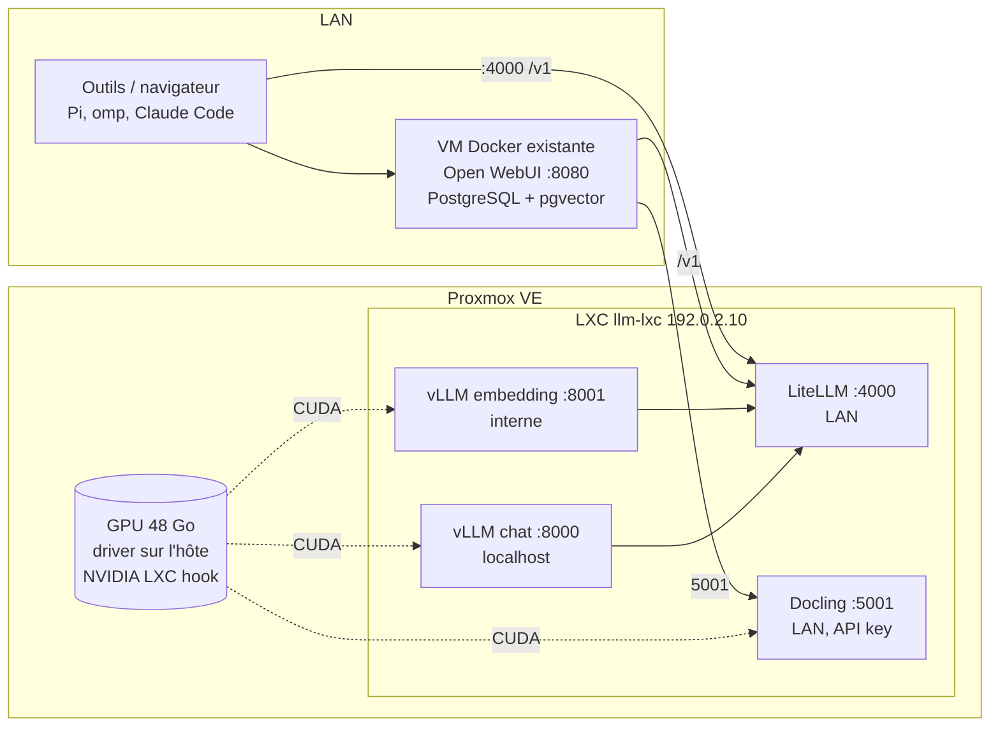

# llm-inference-vm

Stack d'inférence LLM locale sur Proxmox VE, séparée en deux parties :

- **LXC `llm-lxc`** (non privilégié, 192.0.2.10) : **vLLM** (chat +
  embeddings), **LiteLLM** (proxy OpenAI-compatible) et **Docling** (parsing
  GPU). Le GPU reste attaché à l'hôte Proxmox et est injecté dans le LXC par le
  hook NVIDIA + les règles cgroup — **pas de passthrough PCI/VFIO**.
- **VM Docker existante** (celle de tes services) : **Open WebUI** (:8080) +
  **PostgreSQL/pgvector**. Aucun GPU, aucun vLLM, aucun Docling sur cette VM :
  elle consomme LiteLLM et Docling par le LAN.

LiteLLM est le seul point d'entrée pour le chat/les embeddings ; Docling est
exposé avec sa propre API key. vLLM n'est jamais exposé.

## Architecture



| Composant | Où | Exposition | Rôle |
|---|---|---|---|
| vLLM chat | LXC | `127.0.0.1:8000` / réseau Docker | Qwen3.8-27B-NVFP4 + DFlash2 |
| vLLM embedding | LXC | réseau Docker | Qwen3-Embedding-0.6B |
| LiteLLM | LXC | LAN `:4000` | proxy, master key |
| Docling | LXC | LAN `:5001` | parsing + OCR, API key |
| Open WebUI | VM Docker existante | LAN `:8080` | chat + RAG |
| PostgreSQL/pgvector | VM Docker existante | interne | DB applicative + vecteurs |

Ports LAN : `8080` (Open WebUI), `4000` (LiteLLM), `5001` (Docling).
`8000/8001` restent locaux. TLS terminé par le reverse-proxy interne.

## Prérequis

- **Proxmox VE 9.2+**, `lxc-pve >= 6.0.5` (le host de test `pve-node1` est en 9.2.27
  avec `lxc-pve 7.0.0`).
- Driver NVIDIA + `nvidia-container-toolkit` sur l'hôte
  ([docs/HOST-INSTALL.md](docs/HOST-INSTALL.md)).
- Dépôts Debian/PVE locaux (`main contrib non-free non-free-firmware`) sur le
  PVE airgap : ils fournissent `dkms`, `build-essential` et les headers du
  kernel ; le bundle ne les duplique pas.
- Poste de pilotage : `tofu` (OpenTofu ≥ 1.11), `ansible-core` +
  `community.general`, une clé SSH.
- Une VM Docker existante avec **Docker Engine 24+ / Compose v2**, ~4 Go RAM,
  ~20 Go libres, et un accès réseau aux ports `4000`/`5001` du LXC
  ([deploy/openwebui/README.md](deploy/openwebui/README.md)).
- Pour l'airgap : un builder Ubuntu 26.04 amd64 avec internet
  ([docs/AIRGAP.md](docs/AIRGAP.md)).

## Structure

```text
iac/                                  # OpenTofu — LXC uniquement
  providers.tf
  main.tf                             # LXC 120, template Ubuntu 26.04
  variables.tf                        # réseau (bridge/VLAN/IP), ressources
  outputs.tf                          # lxc_ip, litellm_url, docling_url
  terraform.tfvars.example

ansible/
  playbook.yml                        # LXC : base, Docker, vLLM/LiteLLM/Docling
  playbook-download.yml               # wrapper du script airgap (builder)
  requirements.yml                    # collection community.general
  inventory/inventory.yml.example
  group_vars/all.yml.example
  roles/
    airgap                            # apt local du bundle
    lxc_base                          # socle LXC, SSH key-only, timezone
    lxc_security                      # fail2ban temporaire
    developer_config
    inference_user                    # user non-admin
    lxc_docker                        # Docker + toolkit NVIDIA + smoke test
    inference_stack                   # compose vLLM + embedding + LiteLLM + Docling

deploy/openwebui/                     # Docker Compose pour la VM existante
  docker-compose.yml                  # Open WebUI + PostgreSQL/pgvector
  .env.example
  initdb/01-vector.sql
  README.md

scripts/
  proxmox-lxc-gpu.sh                  # features/hooks/cgroup/SHM/bundle LXC
  fetch-airgap-bundle.sh              # builder online : host + images + modèles
  test.pdf                            # PDF de benchmark/validation

docs/
  HOST-INSTALL.md                     # driver/toolkit/hooks/template Proxmox
  AIRGAP.md                           # build/transfert/installation offline
```

## Déploiement

### 1. Préparer l'hôte Proxmox

Suivre [docs/HOST-INSTALL.md](docs/HOST-INSTALL.md) : driver NVIDIA, toolkit,
template LXC. Le host `pve-node1` est déjà préparé.

### 2. Créer le LXC

```bash
cd iac
cp terraform.tfvars.example terraform.tfvars
$EDITOR terraform.tfvars      # API Proxmox, SSH, node, bridge, IP
tofu init
tofu apply
```

Défaut : LXC `llm-lxc` **120** → `192.0.2.10/24`. Le bridge, la gateway,
le VLAN et l'IP sont des variables (`network_bridge`, `network_gateway`,
`network_vlan_id`, `lxc_ipv4`). Aucune VM front n'est créée.

### 3. Ajouter les hooks GPU au LXC

Sur l'hôte Proxmox :

```bash
/path/to/repo/scripts/proxmox-lxc-gpu.sh 120
# airgap : ajouter --bundle /srv/airgap-bundle
```

Le script active `nesting/keyctl/fuse/mknod`, ajoute les règles cgroup des
majors NVIDIA détectés, le hook `/usr/share/lxc/hooks/nvidia`, 16 GiB de
`/dev/shm`, et vérifie `nvidia-smi` dans le LXC. Il ne monte pas `/dev/dri`
(inutile pour CUDA).

### 4. Provisionner le LXC

```bash
cd ansible
cp inventory/inventory.yml.example inventory/inventory.yml
cp group_vars/all.yml.example group_vars/all.yml
$EDITOR group_vars/all.yml
ansible-playbook playbook.yml
```

Le play installe Docker + `nvidia-container-toolkit`, configure le runtime
Docker `nvidia` avec `no-cgroups=true`, puis déploie le compose vLLM +
embedding + LiteLLM + Docling.

### 5. Déployer Open WebUI + PGVector sur ta VM Docker

```bash
cd deploy/openwebui
cp .env.example .env
chmod 600 .env
$EDITOR .env
docker compose config --quiet
docker compose up -d
```

Le `.env` reprend `litellm_master_key`, `docling_api_key`,
`litellm_base_url`, `docling_url` du LXC. Le compose force
`ENABLE_PERSISTENT_CONFIG=false` : `.env` est la source de vérité et les
changements d'UI ne survivent pas au redémarrage. Détails :
[deploy/openwebui/README.md](deploy/openwebui/README.md).

### 6. Accès

- Admin LXC : `ssh root@192.0.2.10`.
- LiteLLM : `http://192.0.2.10:4000/v1` (bearer = `litellm_master_key`).
- Docling : `http://192.0.2.10:5001` (header `X-Api-Key`).
- Open WebUI : `http://<vm>:8080`.
- vLLM : `127.0.0.1:8000` depuis le LXC uniquement.

## Flags principaux (`ansible/group_vars/all.yml`)

| Variable | Défaut | Rôle |
|---|---|---|
| `vllm_start` | `true` | démarre vLLM chat + embedding ; **`false` sur pve-node1** (GPU 8 Go) |
| `vllm_embedding_enabled` | `true` | 2ᵉ vLLM pour les embeddings RAG |
| `docling_gpu` | `true` (cible 48 Go) ; `false` dans les defaults du rôle / pve-node1 | image CUDA + layout/table sur GPU ; **`false` sur pve-node1** |
| `docling_ocr_preset` | `tesseract` | moteur OCR côté Open WebUI (`DOCLING_PARAMS`) |
| `docling_ocr_lang` | `["fr"]` | langues OCR BCP-47 |
| `vllm_enforce_eager` | `false` | workaround si décode NVFP4/DFlash sm120 instable |
| `vllm_gpu_memory_utilization` | `0.78` si Docling GPU, sinon `0.82` | budget VRAM du chat |
| `vllm_embedding_gpu_memory_utilization` | `0.06` | budget VRAM des embeddings |
| `airgap_mode` | `false` | bascule apt/images/modèles hors ligne |

Les tableaux sont réglés dans `deploy/openwebui/.env` via
`DOCLING_PARAMS` (`table_mode=accurate`, TableFormer), pas dans `all.yml`.

## Docling, OCR, tableaux et ingestion

Docling est dans le LXC, avec **deux moteurs OCR disponibles** :

- **Tesseract** (`fra` + `fr` dans `/srv/llm/docling/tessdata/`) :
  CPU, **0 VRAM**, le plus rapide.
- **EasyOCR** (`latin_g2`, déjà dans l'image Docling) : plus robuste sur les
  scans inversés/bruités ; plus lent sur CPU, ~1-2 GB VRAM s'il utilise le GPU.

Le preset `auto` de Docling sélectionne **RapidOCR (chinois/anglais)** ; c'est
la raison pour laquelle « on ne voit que du chinois » si on ne force pas le
preset. Le choix se fait dans Open WebUI via `DOCLING_PARAMS` :

```json
{"ocr_preset":"tesseract","ocr_lang":["fr"],"table_mode":"accurate","do_table_structure":true}
```

```json
{"ocr_preset":"easyocr","ocr_lang":["fr"],"table_mode":"accurate","do_table_structure":true}
```

`ocr_lang` est une **liste** de tags BCP-47. `ocr_engine` est déprécié côté
docling-serve ; utiliser `ocr_preset`.

Mesures sur un PDF de 10 pages (conteneur Docling CPU, `--network none`,
modèles locaux) :

| Moteur | Temps total | Temps/page |
|---|---|---|
| Tesseract/fr | 7,8 s | **0,78 s/page** |
| EasyOCR/fr | 98,6 s | 9,86 s/page |

Sur le site 48 Go, EasyOCR peut utiliser le GPU ; Tesseract reste à 0 VRAM.
Les deux modèles sont locaux : le test offline ne télécharge rien.

**Reconnaissance de tableaux** : `table_mode=accurate` sélectionne
**TableFormer accurate**. Docling le supporte sur **CPU, CUDA et XPU** (pas
MPS) : ce n'est donc **pas GPU-only**. Test sur le Docling CPU de pve-node1, PDF de
2 pages avec un tableau 5 colonnes × 7 lignes : **~2,75 s** de traitement
(4,0 s avec l'aller-retour HTTP), tableaux Markdown corrects. Sur le 48 Go il
tourne sur GPU et va plus vite. `table_mode` et `do_table_structure` sont déjà
les défauts Docling ; on les explicite pour qu'une évolution de défaut ne
régresse pas silencieusement la qualité.

**Précédence de configuration** : le compose Open WebUI force
`ENABLE_PERSISTENT_CONFIG=false`, donc le `.env` gagne sur la DB et l'UI.
Modifier `DOCLING_PARAMS` (ou `ENABLE_SIGNUP`) dans
`deploy/openwebui/.env`, puis `docker compose up -d` (recrée le conteneur avec
le nouvel environnement). Les changements faits dans **Admin → Settings → Documents**
s'appliquent jusqu'au redémarrage mais ne sont pas enregistrés. Pour revenir à
une configuration pilotée par l'UI : `ENABLE_PERSISTENT_CONFIG=true`.

Pour forcer l'OCR sur un PDF avec couche texte, ajouter `"force_ocr":true`.
Pour les documents scientifiques avec formules, MinerU ou Marker peuvent être
meilleurs ; Docling reste le meilleur compromis intégration Open WebUI /
airgap / layout-tableaux pour ce projet.

## Vector DB : PGVector

Open WebUI utilise **PostgreSQL + pgvector** dans `deploy/openwebui` :

- Open WebUI maintient officiellement ChromaDB et PGVector ;
- la même base Postgres sert de DB applicative (`DATABASE_URL`) et de base
  vectorielle (`PGVECTOR_DB_URL`) ;
- `pg_dump`/restauration standard, pas de base embarquée dans le conteneur ;
- `PGVECTOR_INITIALIZE_MAX_VECTOR_LENGTH=1024` (Qwen3-Embedding-0.6B).

Chroma reste possible pour un petit déploiement, mais est moins robuste pour
les backups/migrations. Qdrant est une bonne alternative « vector-native » si
tu vises un très gros volume ou plusieurs instances ; il ajoute un service et
n'est pas maintenu au cœur par Open WebUI. Pour ce site unique, PGVector est
le choix retenu.

## Profil GPU cible : GPU 48 Go

- modèle `unsloth/Qwen3.8-27B-NVFP4` (corps NVFP4, lm_head FP8) ;
- drafter `maurienne-ai/Qwen3.8-27B-DFlash2-NVFP4-RTNcal`
  (`block_size = 8` → `num_speculative_tokens = 7`) ;
- vLLM `v0.34.0` (CUDA 13.0) ;
- `--speculative-config '{"method":"dflash","model":"<drafter>","num_speculative_tokens":7}'` ;
- `--attention-backend flash_attn`, `--kv-cache-dtype nvfp4` ;
- `--max-model-len 262144`, `--max-num-seqs 4`,
  `--max-num-batched-tokens 32768` ;
- budget : chat `0.78 × 48 = 37.4 Go` (Docling GPU actif), embedding
  `0.06 × 48 = 2.9 Go`, Docling layout/table ~4-5 Go ; la marge résiduelle est
  d'environ **2,7-3,7 Go**, à mesurer au premier démarrage (les pics Docling
  peuvent la réduire).

Le host `pve-node1` n'a qu'une **GPU 8 Go** : `vllm_start: false` et
`docling_gpu: false`. On y valide le LXC, Docker, le hook GPU (`nvidia-smi`),
LiteLLM, Docling CPU (Tesseract + EasyOCR), et le compose Open WebUI/PGVector.
Le 27B, DFlash2 et Docling CUDA se valident sur le serveur 48 Go.

## Airgap

Tout est embarqué dans un bundle construit sur un builder connecté :

```bash
sudo ./scripts/fetch-airgap-bundle.sh --output ./airgap-bundle
```

Puis transférer, installer le driver/toolkit, créer le LXC, lancer Ansible, et
déployer Open WebUI/PGVector sur la VM Docker via les images
`open_webui.tar`/`pgvector.tar`. Détails et layout :
[docs/AIRGAP.md](docs/AIRGAP.md). Le script résout les dernières versions au
build et écrit `manifest.json` (images/digests, modèles, driver, Tesseract).
Il ne duplique pas les paquets Debian/PVE de l'hôte (`dkms`, `build-essential`,
`proxmox-headers-$(uname -r)`) : ils viennent de tes dépôts locaux. Le driver
stable 595.x (`download.nvidia.com`), le toolkit NVIDIA, le template LXC, les
images, les modèles et la closure Ubuntu du LXC sont dans le bundle.
Le bundle contient aussi `SHA256SUMS`, vérifié par le rôle `airgap`.

## Opérations

LXC :

```bash
ssh root@192.0.2.10
nvidia-smi
docker ps
docker compose -f /srv/llm/compose/compose.yaml ps
docker logs -f vllm
docker logs -f docling
docker exec docling tesseract --list-langs
curl -s -H "X-Api-Key: $DOCLING_KEY" http://127.0.0.1:5001/health
curl -s -H "Authorization: Bearer $KEY" http://127.0.0.1:4000/v1/models
```

VM Docker :

```bash
cd deploy/openwebui
docker compose ps
docker compose logs -f open-webui
docker compose exec postgres psql -U openwebui -d openwebui -c '\dx vector'
```

## Prochaines étapes

1. Sur le serveur 48 Go : `vllm_start: true`, `docling_gpu: true`, puis
   `ansible-playbook playbook.yml --limit inference_lxc`.
2. Vérifier le chargement du 27B, DFlash2 et le rendu Docling GPU :
   `docker logs -f vllm`, `docker logs -f docling`, `curl :8000/v1/models`.
3. Tester Tesseract puis EasyOCR en prod via `DOCLING_PARAMS` dans
   `deploy/openwebui/.env` (scans inversés, qualité, `table_mode`) puis
   `docker compose up -d` ; garder le meilleur pour ton corpus.
4. Construire/tester le bundle airgap sur le site cible.
5. Sauvegarder PGVector (`pg_dump`) et les volumes Open WebUI.

## Licence

MIT — voir [LICENSE](LICENSE).
